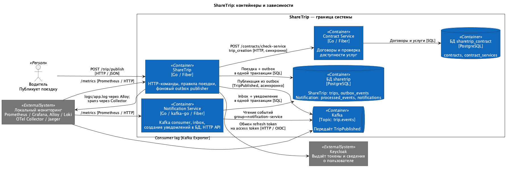
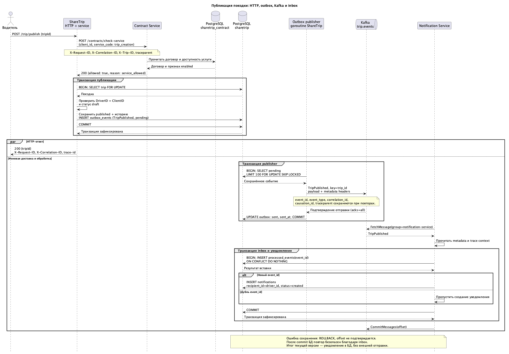

# ShareTrip — five-minute architecture walkthrough

> **Portfolio context:** ShareTrip is a Go microservices learning project developed as part of the [Job4j Senior coursework](https://github.com/anton415/job4j_senior_lessons). This page is a guide to the **existing** code and design, not a claim of production deployment, independently verified runtime tests, or completion of every mentor review item. No new ShareTrip functionality is proposed.

## 1. System at a glance (0:00–1:00)

**Business case:** a driver creates a draft trip and requests its publication. Publication is allowed only when the relevant user/contract permissions and trip-state conditions hold. A successful publication eventually results in an internal notification record.

| Component | Owns | Communication |
| --- | --- | --- |
| [ShareTrip](https://github.com/anton415/share_trip) | Trip state, trip PostgreSQL data, transactional outbox and HTTP endpoints | Calls Contract synchronously; publishes events to Kafka |
| [Contract Service](https://github.com/anton415/sharetrip-contract) | Contract lifecycle and service entitlement rules | HTTP decision: is `trip_creation` allowed? |
| [Notification Service](https://github.com/anton415/sharetrip_notification) | Notification records and processed-event inbox | Consumes `TripPublished` from Kafka; PostgreSQL transaction |
| Supporting infrastructure | Keycloak identity, Kafka transport, PostgreSQL persistence, metrics/logs/traces | Local configuration and operational examples in the main repository |

**Boundary choice:** contract rules are separate from trip lifecycle. Trip publication must synchronously know whether the action is allowed; notification creation can happen asynchronously.

Source: [microservices design review](microservices-review.md).

## 2. Follow one trip publication (1:00–3:00)

1. The client calls `POST /trip/publish` on ShareTrip. Authentication derives user identity from the authorized request; clients do not select an arbitrary trip owner.
2. ShareTrip calls Contract Service's `POST /contracts/check-service` for `trip_creation`. A business denial stops the command before the trip transaction.
3. ShareTrip locks the trip row, verifies owner and `draft` state, then **atomically** updates the trip to `published` and stores `TripPublished` in `outbox_events`.
4. The HTTP response does **not** wait for the notification. The outbox publisher asynchronously sends the stored event to Kafka `trip.events`.
5. Notification Service consumes the event. It writes the event ID to its inbox and creates the notification in one database transaction, then commits the Kafka offset.

**Code tour (open these during the interview):**

- [Trip publication API handler](../internal/api/move_trip_draft_to_published.go)
- [Application orchestration and permission check](../internal/service/publish_trip.go)
- [Transactional trip/outbox logic](../internal/domain/publish_trip.go)
- [Outbox publisher](../internal/events/outbox_publisher.go)
- [Contract decision code](https://github.com/anton415/sharetrip-contract/blob/main/internal/service/check_service.go)
- [Notification consumer handling](https://github.com/anton415/sharetrip_notification/blob/main/internal/service/handle_trip_published.go)
- [Atomic inbox + notification repository](https://github.com/anton415/sharetrip_notification/blob/main/internal/repository/create_from_event.go)

See the more detailed [publication sequence diagram](publish_trip.puml) and [service/contract review](microservices-review.md).

## 3. Discuss one failure, not every technology (3:00–4:15)

**Failure scenario:** Kafka acknowledges an event, but ShareTrip crashes before recording the outbox entry as `sent`. On restart, the publisher may send the **same event again**.

- The outbox prevents losing the publication event when the trip update commits.
- The stable `event_id`, derived from `(trip_id, event_type)`, remains unchanged on retry.
- Notification Service's `processed_events` unique key allows **at-least-once transport with idempotent notification-record creation** for that event.
- If the consumer commits its database transaction but loses the offset acknowledgment, the same inbox rule handles redelivery.

Other cases worth explaining: a Contract denial prevents publishing; a PostgreSQL transaction error rolls back both trip and event; a transient Kafka error leaves a pending outbox entry for retry. The design trades synchronous simplicity for extra background processing, eventual notification consistency and operational complexity.

Source: [Consistency: saga, outbox and inbox](consistency.md).

## 4. Operability and limitations (4:15–5:00)

**Observed design features in the repository:** readiness and Prometheus metrics endpoints, correlated structured logging, Kafka lag dashboards and the documented incident path from HTTP request to outbox, Kafka and inbox. For the actual local setup and troubleshooting sequence, use the [main README](../README.md), not an assumed public live deployment.

**Important boundaries and gaps:**

- The current Notification Service creates a `created` notification **record**. It does not send email, SMS or push notifications. `created` does not mean delivered.
- Kafka/outbox/inbox provide recovery and duplicate-handling patterns for this workflow, **not** a guarantee of exactly-once Kafka delivery or global ACID transactions.
- Documentation and source inspection are not the same as executing the full test suite today; do not claim a fresh green CI run without evidence.
- [Mentor feedback/refactoring items](https://github.com/anton415/share_trip/issues/122) remain part of the Job4j learning record. Do not present this educational system as an independently audited, production-ready service.

## Technical discussion prompts

1. **Why is Contract Service separate?** Its rules and data belong to a different bounded responsibility; the tradeoff is a synchronous dependency during publication.
2. **Why transactional outbox instead of “save, then publish”?** It closes the database/Kafka dual-write gap without trying to share a distributed transaction.
3. **Why an inbox?** Kafka messages can be redelivered; the consumer must make its database side effect idempotent.
4. **What does `200 OK` after publication mean?** The trip state and outbox event committed, not that the notification reached an external channel.
5. **What happens when Kafka is unavailable?** The pending outbox event remains to be retried; the operational concern is backlog growth and recovery monitoring.
6. **What is the biggest limitation of this portfolio?** It demonstrates architectural choices in an educational project, not production traffic or a completed external notification pipeline.

## Present it accurately

Describe **which parts you personally designed, implemented, debugged and can reproduce**, using Git history and test evidence. Attribute the course context. Use this document to guide a conversation, not as proof that every documented component is production hardened.

**Portfolio milestone policy:** no new ShareTrip feature development. Organization transfer, LinkedIn Project and an optional lightweight static portfolio page are separate presentation actions; they should preserve existing history and require the owner's review.
