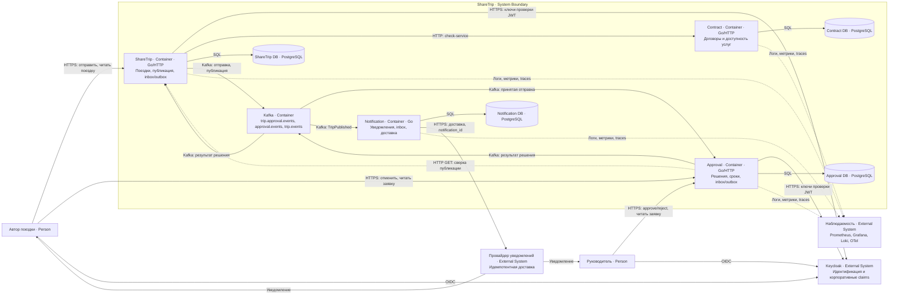
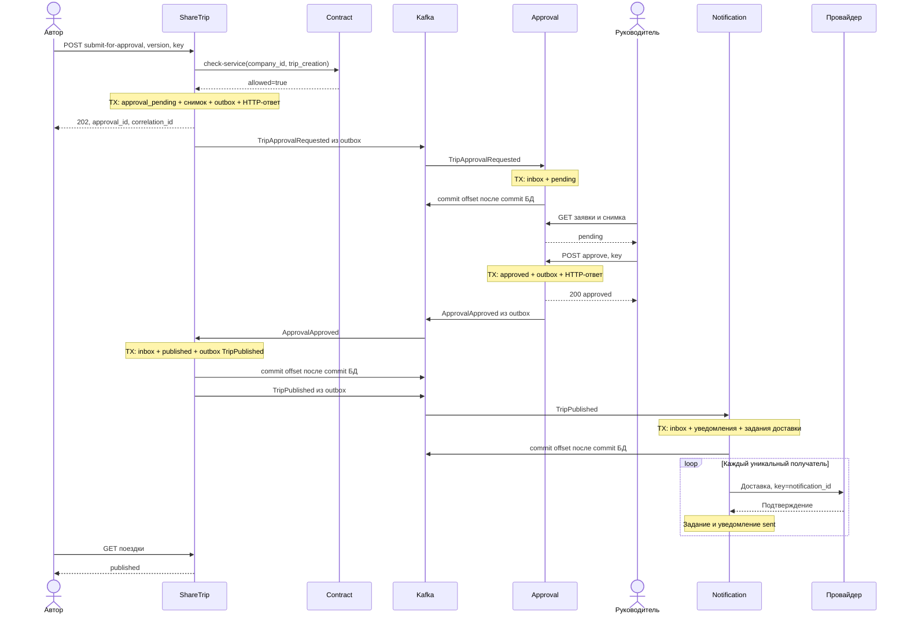
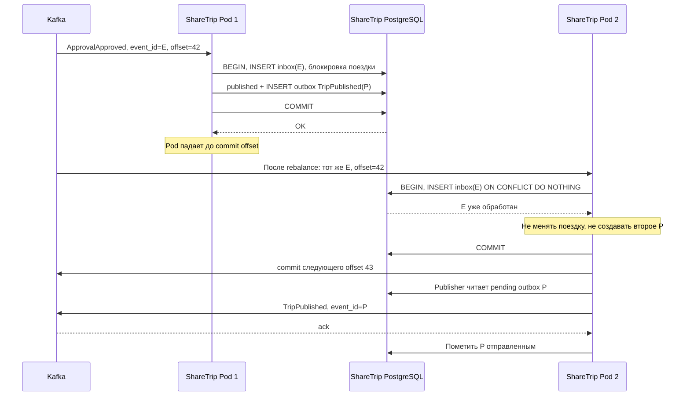

# Согласование корпоративной поездки в ShareTrip

Пользователь отправляет готовый черновик руководителю и после одобрения получает
опубликованную поездку и уведомление. `approval` отвечает за назначенное согласование
и единственное окончательное решение; `sharetrip` сохраняет исключительное право
изменять и публиковать поездку. Между сервисами допускается задержка, но не потеря
принятого решения и не повторение бизнес-эффекта.

Это проект решения контрольного задания, а не описание уже реализованного API.
Изменения прикладного кода, миграции и развёртывание в задание не входят.

## Исходная система и принятые правила

В [текущем процессе](microservices-review.md) уже есть проверка `trip_creation`,
публикация через outbox и создание уведомления через inbox. В модели поездки пока
нет компании и версии; `company_id` события заполняется идентификатором пользователя,
а уведомления только сохраняются в БД. Эти ограничения нужно устранить при будущей
реализации. Здесь описана целевая система с отдельной PostgreSQL-базой каждого сервиса,
как требует условие; совместная учебная БД не является границей владения данными.

Для неоднозначных бизнес-правил приняты следующие решения:

- Корпоративная поездка принадлежит `company_id`; её автор одновременно является
  водителем. Компания, автор и руководитель берутся из доверенного контекста
  идентификации, а не из произвольного JSON клиента. Keycloak выдаёт проверенные
  `sub`, `company_id`, `manager_id` и роли; изменение этих claims пользователем запрещено.
- На одну заявку назначается один руководитель, отличный от автора. Назначение
  фиксируется при отправке; замены согласующего в этом процессе нет. Для approve/reject
  нужны действующая роль руководителя, та же компания и совпадение `sub` с `approver_id`.
- Доступность `trip_creation` проверяется при приёме отправки. Это разрешение на
  конкретную версию поездки: позднейшее отключение услуги не отменяет уже принятую
  заявку. Проверка не резервирует договор и не обещает его активность в момент
  последующего commit. Требование строгой одновременности потребовало бы отдельного
  протокола резервирования в contract.
- Черновик заморожен от принятия отправки до применения результата. Срок решения —
  24 часа от принятия отправки. Отмена разрешена автору только до решения. Одобренная
  заявка не истекает, даже если публикация задержалась.
- Получатели итогового уведомления — автор и согласующий, с удалением повторов.
  Доставка во внешний канал — проектируемое расширение notification; подтверждение
  провайдера означает принятие доставки, но не прочтение человеком.

## Границы ответственности

| Сервис | Собственные данные | Собственные решения |
| --- | --- | --- |
| sharetrip | Поездка, компания, автор/водитель, маршрут, `status`, `version`, текущий `approval_id`, снимок отправки, локальная проекция результата, inbox, outbox, HTTP-идемпотентность | Кто может отправить поездку, готов ли черновик, можно ли его редактировать, какой результат относится к текущей версии, когда публиковать |
| contract | Договоры компании, сроки, статусы, разрешённые услуги | Доступна ли `trip_creation` указанной компании сейчас; не согласует и не публикует поездку |
| approval | Заявки, назначенный согласующий, снимок поездки для просмотра, срок, окончательное решение и его автор/время, inbox, outbox, HTTP-идемпотентность | Кто вправе принять решение или отменить заявку, допустим ли переход, истёк ли срок; не меняет поездку и не интерпретирует договор |
| notification | Уведомления по получателям, состояние и попытки доставки, inbox, задания доставки | Как доставить и повторить уведомление; не решает, одобрена ли заявка или опубликована ли поездка |

Самостоятельная ответственность approval — управлять жизненным циклом решения
руководителя, включая полномочия, конкуренцию и срок. Это самостоятельная модель
согласования, а не прокси для обновления статуса поездки. Выделение оправдано при
отдельном развитии правил согласования; для одного неизменного правила модуль
внутри sharetrip был бы дешевле. Ни один сервис не читает чужую БД.

## Полный успешный сценарий

1. Автор создаёт и заполняет черновик существующими средствами ShareTrip. Интерфейс
   показывает его `version` и отправляет команду согласования с новым `Idempotency-Key`.
2. ShareTrip проверяет токен, владельца, компанию, заполненность и версию черновика,
   наличие назначенного руководителя. Для нового ключа синхронно вызывает contract:
   `POST /contracts/check-service`, `{client_id: company_id, service_code: trip_creation}`.
   Это существующая операция чтения, хотя её HTTP-метод — POST.
3. При `allowed=true` ShareTrip блокирует строку поездки и повторно проверяет статус
   и версию. В одной транзакции сохраняет `approval_pending`, новый `approval_id`,
   неизменяемый снимок и срок, событие `TripApprovalRequested` в outbox и ответ команды.
   Возвращает `202 Accepted`: отправка принята, но заявка ещё может не появиться в approval.
4. Publisher доставляет событие в Kafka. Approval в одной транзакции сохраняет inbox
   и заявку `pending`. Руководитель видит заявку со снимком именно отправленной версии.
   Создание заявки не требует отдельного пишущего HTTP-вызова.
5. Руководитель вызывает approve. Approval проверяет полномочия и срок, атомарно
   меняет `pending → approved`, сохраняет `ApprovalApproved` в outbox и ответ команды.
   `200 OK` подтверждает решение; публикация может ещё ожидать обработки.
6. ShareTrip получает `ApprovalApproved`, сверяет компанию, `approval_id` и версию
   снимка. В одной транзакции сохраняет inbox, переводит поездку в `published`,
   обновляет проекцию решения и записывает `TripPublished` в outbox.
7. Notification получает `TripPublished`. Одна транзакция сохраняет inbox,
   уведомления обоим получателям и задания доставки. Worker отправляет их с
   постоянным ключом `notification_id`, затем отмечает `sent` после подтверждения.
8. Автор видит опубликованную поездку, оба получателя получают уведомление.
   Интерфейс читает поездку через расширяемый `GET /trip/{id}`, заявку через
   проектируемый `GET /approvals/{approval_id}`. Руководитель находит назначенные
   ему заявки через `GET /approvals?status=pending`, с серверным ограничением по
   компании и согласующему. Чтения проверяют доступ; их контракт не входит в набор
   пишущих операций.

До появления заявки GET approval может вернуть 404: UI в этом промежутке показывает
«Отправлено, создаётся заявка» по состоянию ShareTrip и повторяет чтение. При
`approved` и ещё `approval_pending` UI показывает «Одобрено, ожидается публикация».
Новый HTTP-запрос не является способом ускорить уже принятое решение.

## Модели и переходы

Заявка содержит `id`, `trip_id`, `company_id`, `author_id`, `approver_id`, `status`,
`created_at`, `updated_at`. Дополнительно нужны `trip_version` (версия замороженного
снимка), сам `trip_snapshot`, `expires_at`, `correlation_id`, `decision_actor_id`,
`decision_reason`, `decision_event_id`. Последние три поля пусты до решения;
у автоматического истечения `decision_actor_id` пуст. Все ID — UUID, время — UTC.

`created_at` — момент записи заявки в approval; `expires_at` приходит из принятой
отправки. Если событие пришло после срока, approval сразу создаёт `expired` и
`ApprovalExpired` в одной транзакции: просроченная заявка не становится доступной
для одобрения. Терминальные заявки хранятся как история, не переоткрываются.

| Переход заявки | Предусловие | Постусловие |
| --- | --- | --- |
| Нет → pending | Подлинное событие ShareTrip, новый `approval_id`, срок впереди | Снимок и назначение сохранены; активна одна заявка |
| pending → approved | Назначенный руководитель; срок не истёк | Решение и единственное `ApprovalApproved` сохранены |
| pending → rejected | Те же права и срок; непустая причина | Решение и `ApprovalRejected` сохранены |
| pending → cancelled | Автор заявки; срок не истёк | Решение и `ApprovalCancelled` сохранены |
| pending → expired | Время БД не меньше `expires_at` | Решение и `ApprovalExpired` сохранены |
| Нет → expired | Отложенная первая доставка после срока | История просроченной заявки и `ApprovalExpired` сохранены |

Из `approved`, `rejected`, `cancelled`, `expired` переходов нет. Попытка другого
решения возвращает `409 APPROVAL_NOT_PENDING`, для `expired` — `409 APPROVAL_EXPIRED`.
Если срок истёк у ещё `pending`, команда не принимается:
под блокировкой сама фиксирует истечение и событие, возвращает `409 APPROVAL_EXPIRED`;
фоновой worker делает тот же переход, если команд нет. Время проверяется по часам БД
после получения блокировки строки, а не по времени начала ожидания блокировки.

| Переход поездки | Предусловие | Постусловие |
| --- | --- | --- |
| draft → approval_pending | Владелец, готовый черновик, ожидаемая версия, разрешение contract | Версия увеличена; снимок, текущая заявка и outbox сохранены; редактирование запрещено |
| approval_pending → published | `ApprovalApproved` для текущей заявки и версии снимка | Версия увеличена; inbox, публикация и `TripPublished` атомарны |
| approval_pending → draft | `ApprovalRejected`, `ApprovalCancelled` или `ApprovalExpired` для текущей заявки | Версия увеличена; текущая заявка очищена, последний результат доступен; черновик снова редактируется |

Существующее `published → started` остаётся за рамками согласования. Корпоративную
поездку нельзя опубликовать напрямую через существующий `POST /trip/publish`:
будущая реализация обязана отвечать `409 APPROVAL_REQUIRED` и проводить публикацию
только обработчиком соответствующего одобрения. Нельзя редактировать, удалять,
запускать поездку или повторно отправлять её, пока она `approval_pending`.
Отмена заявки не удаляет поездку. Повторная отправка после отрицательного исхода
создаёт новый `approval_id`, новый ключ и новый `correlation_id`.

### Инварианты и конкуренция

Активная заявка — только `pending`. В approval ограничение защищается БД:

```sql
CREATE UNIQUE INDEX one_pending_approval_per_trip
    ON approvals (trip_id) WHERE status = 'pending';
```

Частичный уникальный индекс запрещает вторую активную строку даже при разных ключах
и репликах ([PostgreSQL](https://www.postgresql.org/docs/current/indexes-partial.html)).
Дополнительно ShareTrip под блокировкой допускает отправку только из `draft`:
это закрывает окно до доставки события в approval. После решения новая отправка
ждёт применения результата в ShareTrip. Событие повторного создания с тем же
`approval_id` никогда не переоткрывает завершённую заявку.

Approve, reject, cancel и expiry используют один порядок: запись идемпотентности
(если HTTP), затем `SELECT ... FOR UPDATE` заявки, проверка времени и статуса,
изменение состояния, outbox и ответ, commit. Внешних вызовов под блокировкой нет.
При одновременных approve/reject первая зафиксированная транзакция выигрывает;
вторая после ожидания видит терминальный статус и возвращает 409 без события.
Откатившаяся транзакция победителем не считается. Блокировка в памяти Pod не нужна.

Для одобренной заявки публикация допустима ровно один раз. Помимо inbox используются
проверка текущего `approval_id`, состояние поездки и уникальность бизнес-события
`(approval_id, event_type)` в outbox. Дубли с разными `event_id` тоже не могут повторить
переход. Чужая компания, несовпадающий снимок или противоречащий истории результат —
нарушение протокола с карантином и алертом, а не повод публиковать поездку.

## Синхронные и асинхронные взаимодействия

| Взаимодействие | Вид сообщения | Почему выбран этот способ |
| --- | --- | --- |
| Автор → ShareTrip: submit | Синхронная HTTP-команда | Пользователь сразу узнаёт, принят ли черновик или запрещена услуга |
| ShareTrip → contract: check-service | Синхронный запрос чтения, не команда и не событие | Нужен актуальный ответ владельца договоров перед приёмом отправки |
| ShareTrip → approval: TripApprovalRequested | Асинхронное событие о принятой отправке | Принятое намерение переживает недоступность approval; Kafka не входит в HTTP-транзакцию |
| Пользователь → approval: approve/reject/cancel | Синхронная HTTP-команда | Вызывающий должен узнать результат конкуренции за решение |
| approval → ShareTrip: четыре окончательных исхода | Асинхронные события о факте решения | Публикация восстанавливается независимо от доступности ShareTrip |
| ShareTrip → notification: TripPublished | Асинхронное событие | Уведомление не увеличивает время и не отменяет публикацию |
| Worker notification → провайдер | Команда доставки с подтверждением | Выполняется асинхронно относительно процесса; нужен результат конкретной попытки |

`TripApprovalRequested` означает уже сохранённую отправку, а не просьбу получателю
повторно проверить договор. Координация — хореография событий с локальными
транзакциями; отдельного orchestrator или распределённой транзакции нет.

## Пишущие HTTP-контракты

Каждый файл — самостоятельная спецификация OpenAPI 3.0.3 с одной операцией,
её request, response, ошибками и схемами внутри того же файла. Формат соответствует
[OpenAPI](https://spec.openapis.org/oas/v3.0.3).

| Сервис и операция | Файл | Успех |
| --- | --- | --- |
| ShareTrip: `POST /trip/{trip_id}/submit-for-approval` | [submit_trip_for_approval.yaml](../api/operations/submit_trip_for_approval.yaml) | 202, ID заявки и `approval_pending` |
| Approval: `POST /approvals/{approval_id}/approve` | [approve_trip.yaml](../api/operations/approve_trip.yaml) | 200, `approved` |
| Approval: `POST /approvals/{approval_id}/reject` | [reject_trip.yaml](../api/operations/reject_trip.yaml) | 200, `rejected` |
| Approval: `POST /approvals/{approval_id}/cancel` | [cancel_trip_approval.yaml](../api/operations/cancel_trip_approval.yaml) | 200, `cancelled` |

Создание исходного черновика — существующий процесс вне этой доработки. Создание
заявки, истечение, публикация и доставка не имеют новых публичных пишущих ручек:
их запускают consumer/worker. Проверка contract не пишет данные и не требует
`Idempotency-Key`. Пустое тело approve/cancel передаётся как `{}`. Автор, компания
и согласующий не принимаются от клиента; сервисы проверяют подпись, issuer,
audience, срок токена и полномочия также при выдаче сохранённого ответа.

### Идемпотентность HTTP

Клиент генерирует случайный UUID для одного намерения **до первой попытки**,
сохраняет до ответа и использует тот же ключ при таймауте. Для нового намерения
создаёт новый ключ. Области уникальности независимы в БД каждого сервиса:

| Операция | Уникальная комбинация |
| --- | --- |
| submit | `(company_id, actor_id, submit_trip_for_approval, trip_id, key)` |
| approve | `(company_id, actor_id, approve_trip, approval_id, key)` |
| reject | `(company_id, actor_id, reject_trip, approval_id, key)` |
| cancel | `(company_id, actor_id, cancel_trip_approval, approval_id, key)` |

В PostgreSQL `http_idempotency` хранит эту комбинацию под UNIQUE, SHA-256
канонического JSON-запроса (порядок полей/пробелы незначимы), HTTP-статус, тело,
`command_id` принятой команды, время завершения и исходный `correlation_id`.
Один ключ допускает только один hash.
Успех и окончательные бизнес-отказы хранятся 30 суток. Затем удаляется объёмное тело,
но комбинация ключа и hash остаются до удаления агрегата: старый ключ получает
`409 IDEMPOTENCY_KEY_EXPIRED` и не исполняется заново. ID агрегатов не переиспользуются.

- Тот же ключ и тело: вернуть сохранённые HTTP-статус и JSON, даже если заявка уже
  перешла дальше. `Idempotency-Replayed: true`; состояние сейчас читается через GET.
- Тот же ключ и другое тело: `409 IDEMPOTENCY_KEY_REUSED`, исходный результат не меняется.
- Одновременный запрос с тем же ключом ждёт уникальную запись до 1 секунды; если
  результат ещё не доступен, `409 REQUEST_IN_PROGRESS` и `Retry-After: 1`.
- Отсутствующий/неверный ключ — 400. Ошибки аутентификации и авторизации, валидации,
  404, `REQUEST_IN_PROGRESS`, 429 и технические 5xx не кэшируются как окончательный
  результат. В частности, временный 404 до создания заявки допускает повтор с тем же ключом.
- После 5xx/потери ответа неизвестно, был ли commit: повторять тот же ключ.
  При commit восстановится ответ, при rollback команда выполнится заново.

Для submit сохранённый результат ищется **до** повторной проверки contract.
Если его нет, contract вызывается вне транзакции. Затем транзакция захватывает
уникальный ключ и строку поездки, повторно проверяет состояние/версию и фиксирует
результат. Две конкурентные первичные проверки contract допустимы: это чтение.
`allowed=false` сохраняется как бизнес-отказ без изменения поездки; временный сбой
contract возвращает 503 без завершённой записи идемпотентности. Новый запрос после
изменения договора требует нового ключа, если прежний уже получил бизнес-отказ.

Разные ключи не заменяют бизнес-инварианты. Вторая отправка получает
`409 ACTIVE_APPROVAL_EXISTS` либо `409 TRIP_VERSION_CONFLICT`; второе решение —
`409 APPROVAL_NOT_PENDING`. Ошибка транзакции откатывает и ответ, и бизнес-изменение,
и outbox. Для истечения, обнаруженного HTTP-командой, commit сохраняет событие
истечения вместе с окончательным ответом 409.

## События и порядок доставки

Новые approval-события используют JSON-конверт ниже. Все поля обязательны;
`traceparent`/`tracestate` передаются дополнительно в Kafka headers при наличии.
`schema_version` — положительное целое, `occurred_at` — UTC RFC 3339, ID — UUID.

```json
{
  "event_id": "11111111-1111-4111-8111-111111111111",
  "event_type": "ApprovalApproved",
  "schema_version": 1,
  "occurred_at": "2026-10-12T09:05:00Z",
  "correlation_id": "22222222-2222-4222-8222-222222222222",
  "causation_id": "33333333-3333-4333-8333-333333333333",
  "trip_id": "44444444-4444-4444-8444-444444444444",
  "approval_id": "55555555-5555-4555-8555-555555555555",
  "company_id": "66666666-6666-4666-8666-666666666666",
  "data": {
    "trip_version": 8,
    "status": "approved",
    "decision_actor_id": "77777777-7777-4777-8777-777777777777",
    "decided_at": "2026-10-12T09:05:00Z"
  }
}
```

| event_type | Источник и topic | Обязательные поля `data` сверх конверта |
| --- | --- | --- |
| TripApprovalRequested | ShareTrip, `trip.approval.events` | `trip_version` integer ≥1, `author_id`, `approver_id` UUID, `submitted_at`, `expires_at` timestamp, `trip_snapshot` |
| ApprovalApproved | Approval, `approval.events` | `trip_version`, `status=approved`, `decision_actor_id`, `decided_at` |
| ApprovalRejected | Approval, `approval.events` | То же, `status=rejected`, `reason` string 1–1000 символов |
| ApprovalCancelled | Approval, `approval.events` | То же, `status=cancelled`, actor — автор |
| ApprovalExpired | Approval, `approval.events` | `trip_version`, `status=expired`, `decided_at`, `expires_at`; без actor |

`trip_snapshot` содержит `driver_id` UUID, `from_point`/`to_point` непустые строки,
`departure_time` timestamp, `seats` integer ≥1. Версия в событии отправки — версия
поездки **после** перехода в `approval_pending`; далее она неизменна до результата.
`submitted_at` и `expires_at` устанавливает ShareTrip, а approval использует их
для единого срока, независимо от задержки Kafka.

`TripPublished` остаётся в `trip.events` и сохраняет существующий плоский формат:
`event_id`, `event_type=TripPublished`, `occurred_at`, `correlation_id`, `causation_id`,
`trip_id`, `driver_id`, `company_id`, `traceparent`. Добавляются `schema_version=2`,
`approval_id`, `trip_version` (версия опубликованной поездки), `recipient_ids`
(непустой массив уникальных UUID автора и согласующего). Типы metadata те же,
что у конверта. Отдельное описание плоского формата исключает незаметную поломку
существующего consumer. Перед включением корпоративного процесса notification
обновляется для версии 2; отсутствие версии означает старый формат с одним водителем.

`correlation_id` создаёт ShareTrip для каждой принятой отправки, хранит в агрегатах
и возвращает клиенту. Команды решения продолжают сохранённый correlation, а не
доверяют входному заголовку. `causation_id` для события от HTTP — ID принятой команды,
от consumer — входной `event_id`, для фонового expiry — ID события отправки.
Повтор HTTP не меняет исходную цепочку. **Дедупликация события выполняется по
`event_id`, никогда по `correlation_id`**: в одном процессе несколько разных событий.

Ключ Kafka всех событий — `trip_id`: связанные сообщения одного topic попадают
в одну partition. Между topics общего порядка нет. Publisher сериализует отправку
по поездке и отправляет ранее созданное событие до следующего; retry сохраняет
тот же ID и payload. Consumer обрабатывает partition последовательно и не
подтверждает offset дальше необработанного сообщения. Решение невозможно до
создания заявки, а следующая отправка — до применения предыдущего результата.
Эти причинные зависимости и проверка `approval_id` важнее предположения о глобальном порядке.

После failover поздний дубль старого события может оказаться за новым; постоянный
inbox и история уже применённых результатов превращают его в no-op. Результат
для другой заявки не применяется к текущей поездке. Kafka ACL разрешают публикацию
отправок/поездок только ShareTrip, а решений — только approval; consumer проверяет
обязательные поля, тип, версию и соответствие компании/заявки своей модели.

## Локальные транзакции и восстановление

| Транзакция | Что фиксируется атомарно | Дедупликация |
| --- | --- | --- |
| ShareTrip submit | `trips` + снимок отправки + outbox `TripApprovalRequested` + HTTP-ответ | Область HTTP-ключа; блокировка поездки |
| Approval принимает отправку | Inbox + заявка; при просрочке также outbox `ApprovalExpired` | `(consumer_name=approval-create, event_id)`; PK заявки и уникальная активная заявка |
| Approval принимает решение/истечение | Состояние + данные решения + outbox исхода + HTTP-ответ, если он есть | HTTP-ключ и проверка `pending`; уникальный терминальный исход заявки |
| ShareTrip применяет исход | Inbox + поездка + проекция исхода + outbox `TripPublished` только для одобрения | `(consumer_name=sharetrip-approval-result, event_id)` и текущая заявка |
| Notification принимает публикацию | Inbox + уведомления + задания доставки | `(consumer_name=notification-trip-published, event_id)`; UNIQUE `(approval_id, recipient_id, type)` для корпоративных уведомлений |

В inbox сохраняются ID и hash payload. Совпавший ID с другим payload — ошибка
протокола. Обычный дубль завершает транзакцию без повторного бизнес-эффекта, после
чего offset можно подтвердить. Inbox и бизнес-изменение не фиксируются раздельно.
Approval и ShareTrip имеют outbox; в notification таблица заданий доставки выполняет
ту же функцию относительно внешнего канала. Contract в этом процессе только читает.

Publisher выбирает непереданные записи с блокировкой/lease в общей БД, отправляет
с `acks=all` и только после подтверждения помечает отправленными. Несколько реплик
не отправляют разные новые события одной поездки одновременно. После сбоя между
Kafka ack и отметкой БД возможна повторная отправка с исходным `event_id`.
Lease имеет срок, а поздний worker не может подтвердить запись с чужим token lease.

Kafka и PostgreSQL не составляют общую транзакцию: используется at-least-once
доставка и идемпотентный бизнес-эффект, а не обещание exactly-once транспорта
([Kafka delivery semantics](https://kafka.apache.org/40/design/design/)). Offset
фиксируется только после commit БД. При потере соединения во время commit исход
не угадывается — следующая попытка проверяет inbox/ключ.

Consumer при временной ошибке оставляет offset, приостанавливает partition и
повторяет с exponential backoff 1–60 секунд и jitter, сохраняя heartbeat группы.
Неподдерживаемая версия или повреждённое сообщение сохраняется в локальном карантине
с raw payload, topic/partition/offset и причиной, прежде чем подтвердить offset;
поднимается алерт. После исправления оператор повторяет исходное событие с тем же ID.
Карантин не считается успешным inbox. Зависимые нарушения также требуют восстановления,
а не обхода проверки версии.

Inbox и компактные бизнес-маркеры сохраняются весь срок жизни агрегата; автоматической
TTL-очистки нет. Kafka retention задаётся 30 суток. Непереданный outbox не удаляется,
отправленный архивируется на срок жизни агрегата: при длительном простое сообщения
за пределами retention можно восстановить из архива с исходными ID. Очистка истории
и восстановление из backup должны учитывать тот же период replay.

Для внешней доставки worker использует `notification_id` как ключ провайдера.
Необходим провайдер, сохраняющий дедупликацию на весь поддерживаемый срок повторов
и позволяющий проверить исход по этому ID. При таймауте повторяется прежний ключ;
успех и обновление `sent` могут разойтись во времени, но не создают новую отправку.
Если провайдер этого не гарантирует, exactly-once внешняя доставка невозможна:
возможны дубли, и такой канал не удовлетворяет выбранному требованию без доработки.
Постоянная ошибка адресата сохраняется как `failed` с диагностикой; после исправления
повторяется то же задание. Публикация поездки от доставки не откатывается.

## Отказные сценарии

| Отказ | Наблюдаемое состояние | Retry и восстановление | Компенсация | Что видит пользователь |
| --- | --- | --- | --- | --- |
| Contract недоступен при submit | Поездка `draft`; заявки и outbox нет | Не более 2 повторов чтения в общем deadline 2 секунды, затем 503; клиент повторяет тот же ключ с backoff | Не нужна: отправка не принята | «Проверка договора недоступна, повторите позже» |
| Ответ HTTP потерян | Commit мог пройти, состояние проверяется по ключу | Повтор того же ключа/тела возвращает сохранённый ответ; при rollback исполняет команду | Не нужна | Та же заявка/решение; актуальный этап через GET |
| Kafka недоступна после commit | Изменение и pending outbox сохранены | Publisher повторяет с backoff 1–60 секунд и тем же event_id | Не нужна; принятый факт не отменяется | «Отправлено» либо «Одобрено, ожидается публикация» |
| Событие пришло дважды | Inbox уже содержит event_id | Проверить inbox и подтвердить offset без изменения; иной ID защищён бизнес-инвариантом | Не нужна | Одна заявка, публикация и запись уведомления на получателя |
| Две реплики исполняют approve/reject | Одна держит блокировку строки | Победитель получает 200, проигравший 409 с актуальным статусом; retry проигравшего не меняет решение | Не нужна | Одно окончательное решение |
| ShareTrip временно не обрабатывает одобрение | Approval `approved`, поездка `approval_pending`; растёт lag/возраст | Возобновить consumer с прежнего offset; по истечении retention replay из outbox-архива | Не нужна; одобрение не истекает | «Одобрено, ожидается публикация», затем `published` |
| Notification недоступен | Поездка уже `published`, событие сохранено | Восстановить consumer; затем обработать очередь доставки; при постоянной ошибке исправить адресата | Не нужна | Поездка доступна, уведомление задержано |
| Pod упал после изменения, до offset commit | Если commit БД был — есть inbox и эффект; иначе нет обоих | Kafka повторит сообщение, inbox распознает дубль либо транзакция выполнится заново | Не нужна | Без повторной публикации/уведомления |
| Решение конкурирует с cancel/expiry | Единая блокировка и проверка времени определяют один исход | Прочитать актуальную заявку после 409; автоматический retry другого решения запрещён | При cancel/expiry черновик разблокируется событием, это штатный исход | «Отменено»/«Истёк срок» либо уже принятое решение |

Для 429/503 соблюдается `Retry-After`; клиент не повторяет бизнес-ошибки бесконечно.
Если после одобрения ShareTrip обнаруживает нарушение инварианта, поездка остаётся
замороженной, событие попадает в карантин и оператор устраняет причину. Автоматически
отклонять уже одобренную заявку или создавать «компенсирующий reject» нельзя.

## Approval в Kubernetes

Целевой `Deployment/approval` в namespace `sharetrip`: минимум 2 реплики одного
stateless приложения Go, HTTP API, consumer, expiry worker и outbox publisher.
`Service/approval` типа ClusterIP направляет port 80 на HTTP 8080 по label `app=approval`;
внешний ingress маршрутизирует `/approvals`. У каждой службы свой DB user и база.

- ConfigMap: `HTTP_ADDR=:8080`, `KAFKA_BROKERS`, входной topic
  `trip.approval.events`, выходной `approval.events`, `KAFKA_GROUP_ID=approval-service`,
  параметры backoff, `APPROVAL_TTL=24h`, issuer/audience JWT, endpoint OTel.
  Единый TTL отправки использует и ShareTrip; `expires_at` события — авторитетный срок.
- Secret: `DATABASE_URL`, Kafka TLS/SASL credentials, при необходимости секрет
  клиента идентификации. Только ссылки в Deployment, никаких значений в Git/логах.
  ConfigMap/Secret через env требуют нового rollout для применения изменений.
- `GET /live`: отвечает работающий процесс; не проверяет PostgreSQL, Kafka, contract.
  Сбой внешней зависимости не должен вызывать бесконечные рестарты.
- `GET /ready`: инициализация, совместимая схема и доступность своей БД с коротким
  timeout. Kafka не обязательна для HTTP-решения, поскольку запись идёт в outbox;
  её сбой контролируется отдельными метриками. Readiness не останавливает consumer:
  при недоступности БД worker сам приостанавливает работу и не коммитит offsets.
- `startupProbe /live`: period 2s, failureThreshold 30; readiness: period 5s,
  timeout 1s, failureThreshold 3; liveness: period 10s, timeout 1s, failureThreshold 3.
- RollingUpdate: `maxUnavailable=0`, `maxSurge=1`; requests CPU 100m/memory 128Mi,
  limits CPU 500m/memory 256Mi как стартовые параметры, уточняемые нагрузкой.
  Миграции отдельным Job перед rollout, совместимы со старой и новой версиями.
- При SIGTERM приложение снимает readiness, прекращает новые HTTP-команды и fetch,
  завершает локальные транзакции и подтверждает только обработанные offsets.
  `terminationGracePeriodSeconds=30`; незавершённые операции откатываются/повторяются.

Consumer replicas используют одну группу; число работающих consumers ограничено
partitions, остальные могут обслуживать HTTP. Все реплики используют общие
ограничения PostgreSQL. Expiry worker выбирает строки `FOR UPDATE SKIP LOCKED`;
локальная память не является источником состояния. Поведение probes соответствует
[Kubernetes](https://kubernetes.io/docs/concepts/workloads/pods/probes/).

## Наблюдаемость и расследование

Структурированный JSON-лог: `timestamp`, `level`, `service`, `operation`, `result`,
`duration_ms`, `request_id`, `correlation_id`, `causation_id`, `event_id`, `trip_id`,
`approval_id`, `company_id`, `actor_id`, `state_from`, `state_to`, `error_code`,
`trace_id`, `span_id`; для Kafka — `topic`, `partition`, `offset`, `consumer_group`,
`attempt`. ID не помещаются в labels метрик. Токены, адреса доставки, текст причины
отказа и снимок поездки не логируются; ID доступны только уполномоченным операторам.

HTTP передаёт W3C `traceparent`/`tracestate`; outbox сохраняет context принятой
команды, publisher передаёт его в Kafka headers, consumer создаёт processing span.
После долгого ожидания решения начинается новый trace со span link к отправке;
один `correlation_id` связывает все traces процесса. Retry имеет новый span,
но старые `event_id` и correlation. Источник metadata — сохранённый payload,
дублирующие headers должны совпадать; конфликт отправляется в карантин.

| Метрика | Labels с фиксированным набором значений |
| --- | --- |
| `approval_commands_total`, `approval_command_duration_seconds` | `operation=submit/approve/reject/cancel`, `result=success/business_error/technical_error` |
| `approval_decisions_total` | `status=approved/rejected/cancelled/expired` |
| `approval_pending_count`, `approval_pending_oldest_age_seconds` | Без ID; возраст от submitted_at |
| `outbox_pending_count`, `outbox_oldest_age_seconds` | `service=sharetrip/approval` |
| `consumer_lag`, `consumer_errors_total`, `inbox_duplicates_total` | Настроенные `group`, `topic`; для ошибок конечный `reason` |
| `approval_publication_duration_seconds` | В ShareTrip от decided_at до публикации; без ID |
| `approval_unpublished_count`, `approval_unpublished_oldest_age_seconds` | Без ID; периодическая сверка approved с GET ShareTrip |
| `notification_delivery_total`, `notification_delivery_oldest_age_seconds` | Фиксированные `channel`, `result=sent/retry/failed` |
| `quarantine_messages_total` | `service`, конечный `reason=schema/identity/invariant` |

Возраст непубликованных одобрений нельзя получить только histogram завершённых
публикаций. Фоновая сверка approval постранично проверяет собственные `approved`
через read API ShareTrip, хранит диагностический признак `publication_observed_at`,
но не меняет бизнес-статус. Ошибка чтения считается неизвестностью и отдельной
ошибкой сверки, не доказательством отсутствия публикации.

Dashboard «Trip approval»: воронка принятых отправок/решений/публикаций/доставок,
pending и возраст, HTTP p95 и ошибки, lag по группам, outbox backlog и возраст,
неопубликованные одобрения, retry/failed доставки. Счётчики фиксируются после commit;
для диагностики расхождений используются данные БД, поскольку crash может потерять
обновление in-memory метрики. Панель логов ищет по correlation, затем ведёт в traces.

Начальные пороги алертов, уточняемые после нагрузочного запуска:

1. `outbox_oldest_age_seconds > 60` в течение 5 минут — задержка отправки событий.
2. `approval_unpublished_oldest_age_seconds > 120` в течение 5 минут при успешной
   сверке — принятое одобрение не привело к публикации.
3. Положительный lag без успешной обработки 5 минут — consumer остановился.
4. Возраст задания доставки >300 секунд в течение 5 минут либо постоянный `failed` —
   пользователи не получили уведомление.
5. Любое новое сообщение в карантине — несовместимая схема или нарушение инварианта.

Расследование «одобрено, но не опубликовано»:

1. Найти заявку по `approval_id`, взять её correlation и `decision_event_id`.
   Проверить `approved`, время решения и сохранённый outbox в approval.
2. По event_id найти попытки publisher. Pending outbox указывает на отправку;
   sent — на необходимость проверки Kafka topic/partition/offset и consumer lag.
3. Проверить inbox `sharetrip-approval-result` по тому же event_id. Если записи нет,
   искать consumer retry, карантин, ошибки схемы/БД и соответствующие traces.
4. Если inbox есть, в той же транзакции должен быть зафиксирован результат:
   проверить текущую заявку/историю поездки и outbox `TripPublished`, у которого
   `causation_id` равен ID одобрения. Противоречие — нарушение инварианта, не повод
   вручную посылать новое одобрение.
5. Для опубликованной поездки продолжить по event_id `TripPublished` в notification
   inbox и задания доставки. Восстановить зависимость и повторить исходное событие
   с тем же ID; correlation помогает собрать цепочку, но не подавляет её события.

## Диаграммы

### C4 Container

Диаграмма уровня контейнеров: рамка обозначает систему ShareTrip, внутри находятся
приложения, брокер и отдельные хранилища; подписи содержат технологии и ответственность.



### Успешный сценарий



### Перезапуск после commit до подтверждения offset



## Компромиссы и альтернативы

| Решение | Цена | Альтернатива и условие выбора |
| --- | --- | --- |
| Отдельный approval | Ещё БД, деплой и eventual consistency | Модуль ShareTrip проще, если правила согласования не имеют самостоятельного развития |
| Sync contract, async остальная цепочка | Отказ contract блокирует приём, после 202 нужна индикация ожидания | Кэш допуска услуг повышает доступность, но принимает заявки по устаревшему договору |
| Проверка договора только при отправке | Уже принятое разрешение переживает отключение договора | Перепроверка при публикации требует нового бизнес-исхода для уже одобренной заявки; резервирование даёт более строгую гарантию за счёт сложности |
| Хореография и восстановление вперёд | Прогресс распределён по сервисам, требуется сквозная диагностика | Saga-orchestrator полезен при появлении бронирования, платежей и реальных компенсаций |
| HTTP-ключи в той же PostgreSQL | Хранение ответов и компактных маркеров растёт | Redis с TTL дешевле для короткого кэша, но не даёт атомарности с бизнес-транзакцией и защиты позднего повтора |
| Заморозка снимка | Автор ждёт отмены/отказа перед редактированием | Изменения во время согласования требуют версий заявок и явного аннулирования устаревших решений |

## Проверка проекта и подготовка к защите

Перед будущей реализацией поведенческие критерии проверяются сценариями:

1. Успешная цепочка создаёт одну заявку, один переход публикации и одно уведомление
   каждому уникальному получателю; компания не подменяется ID пользователя.
2. Параллельные submit с разными ключами создают не более одной активной заявки;
   параллельные approve/reject/cancel/expiry фиксируют ровно один исход.
3. Повтор ключа возвращает исходный ответ, изменение тела — 409, старый ключ после
   удаления тела не запускает новый процесс. Replay события не повторяет эффект.
4. Падение в каждой границе commit/ack/offset восстанавливается без потери факта;
   техническая ошибка contract оставляет поездку черновиком.
5. Замороженная версия не редактируется; старое решение не публикует новую версию;
   прямой HTTP publish не обходит согласование.
6. Задержки Kafka, ShareTrip и notification видны в UI и алертах; недоставленное
   уведомление не откатывает опубликованную поездку.

Короткий план устной защиты: цель и владельцы данных → две машины состояний →
четыре HTTP-команды и области ключей → outbox/inbox на диаграмме → гонка решений →
сбой до offset → диагностика неопубликованного одобрения → цена выделения сервиса.

На вопрос «почему нельзя обойтись event_id?» ответ: он устраняет повтор доставки,
но не две разные команды с разными ключами; нужны доменные ограничения. На вопрос
«почему нет rollback всей цепочки?» ответ: принятые решения долговечны, публикация
и уведомление повторяются вперёд, а необратимых резервирований здесь нет. На вопрос
«200 approve означает опубликовано?» ответ: подтверждено только решение approval;
готовность поездки определяется владельцем поездки.
